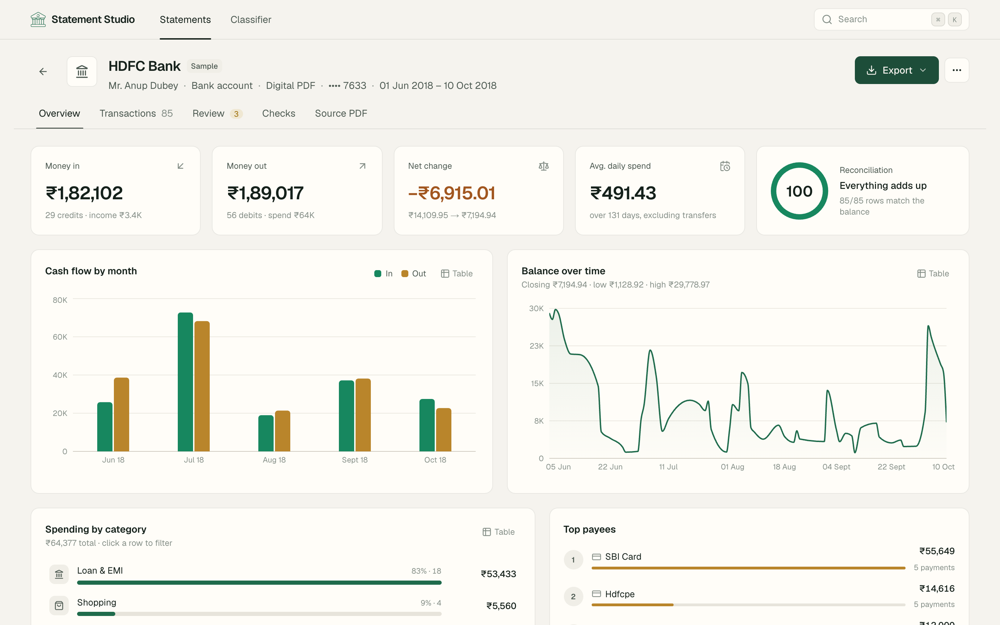
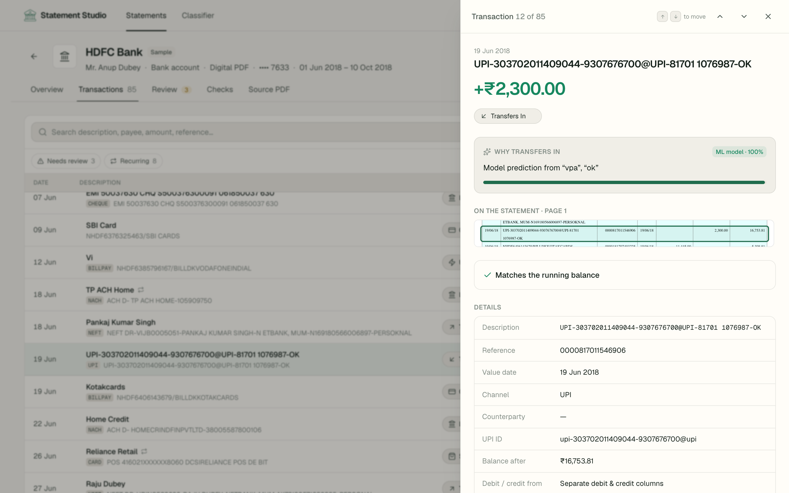
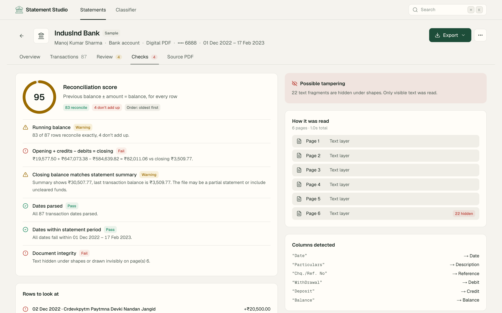
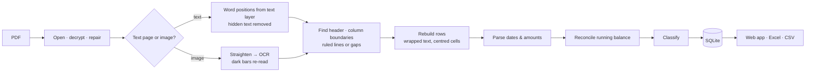

# Statement Studio

Turns Indian bank and credit-card statement PDFs, digital or scanned, into reconciled, categorised data you can export to Excel or CSV. Transactions are classified **without LLMs**, using banking rules, a merchant dictionary and a traditional ML model.



## What it does

- **Reads any layout.** There are no per-bank templates: the table is rebuilt from where words sit on the page. Tested on HDFC, ICICI, SBI, Union, IndusInd and Indian Bank statements, plus 1,500 randomly generated layouts.
- **Handles scanned PDFs.** Each page is checked to see whether it has real text or is an image. Image pages go through OCR (RapidOCR, with Tesseract as an option) after straightening, and white-on-dark header bars are handled.
- **Checks every balance.** Every row must satisfy *previous balance ± amount = balance*. This catches misread rows, and works out debit or credit when a statement shows only an unsigned amount. Rows that don't add up are flagged and kept exactly as printed, never silently "fixed".
- **Detects edited PDFs.** Text hidden under shapes or drawn in the background colour is ignored and reported as possible tampering.
- **Explains every category.** Each transaction shows which layer decided its category, how confident it was, and the likely alternatives.
- **Learns from corrections.** Recategorise one transaction, then apply it to every transaction with the same payee, save it as a rule for future uploads, or retrain the model.
- **Handles real-world quirks:**
  - password-protected and damaged PDFs
  - newest-first statements
  - wrapped descriptions
  - Hindi-English headers
  - `Cr`/`Dr` written in different ways
  - US-style dates
  - overlapping statements for the same account
  - duplicate uploads
  - transfers between your own accounts
- **Insights.** Cash flow, balance trend, spending by category, top payees, recurring payments (EMIs, SIPs, subscriptions, salary) and a daily-spend calendar.
- **Export.** An Excel workbook with Summary, Transactions, Categories, Monthly, Recurring and Validation sheets. It includes native charts and formulas, plus a category drop-down so you can recategorise inside Excel. Or a CSV.

<table>
<tr>
<td></td>
<td></td>
</tr>
<tr>
<td align="center"><sub>Each transaction links back to its row in the original PDF</sub></td>
<td align="center"><sub>An edited statement: hidden text found, inconsistent rows flagged</sub></td>
</tr>
</table>

## Results

| Measure | Result |
|---|---|
| Real statements (8 PDFs, 6 banks) | Every row extracted. All untampered statements reconcile 100%, except where the statement itself is inconsistent; those rows are flagged. |
| Random digital layouts (`scripts/layout_fuzz.py`) | 1,500 / 1,500 extracted exactly |
| Random scanned layouts (110 DPI, skewed, noisy) | about 85% exact. Rows OCR still misreads are caught by the balance check. |
| Categories, real descriptions (161 hand-labelled) | 97.5% hybrid vs 77.0% ML only\* |
| ML model, people and shop names never seen in training | 89.8% accuracy, macro-F1 0.91 |

\*The hand-labelled set was also used while writing the rules, so treat it as a regression check, not a blind test. The unseen-names score is the blind one.

## How it works



**Classification** goes through these layers in order. The first confident answer wins:

1. **Your rules.** Payees you've corrected before.
2. **Banking rules.** Reversals, salary, interest, charges, ATM, EMI, SIP, tax, card bills. These are aware of direction, so a debit can never be "Salary".
3. **Merchant dictionary.** 221 Indian merchants and billers (362 spellings).
4. **ML model.** Word and character-pattern features fed to logistic regression, trained on 24k synthetic descriptions. It generalises to shops no list contains, e.g. "SAI KRUPA MEDICAL STORE" → Healthcare.
5. **Payment channel.** UPI to a person → transfer; merchant QR code → purchase.

Anything below 70% confidence goes to a review queue.

## Tech stack

| | |
|---|---|
| Backend | Python 3.12, FastAPI, PyMuPDF, pikepdf, RapidOCR (ONNX), OpenCV, scikit-learn, XlsxWriter, SQLite |
| Frontend | Next.js 15, React 19, TypeScript, Tailwind CSS 4, TanStack Query & Virtual, Recharts, Framer Motion, Radix UI, react-pdf, Lottie |

## Run locally

Requires Python 3.12 and Node 20+ (with pnpm).

```bash
# backend → http://localhost:8000
cd backend
python3.12 -m venv .venv && .venv/bin/pip install -r requirements-dev.txt
.venv/bin/uvicorn app.main:app --reload --port 8000

# frontend → http://localhost:3000
cd frontend
cp .env.example .env.local      # NEXT_PUBLIC_API_URL=http://localhost:8000
pnpm install && pnpm dev
```

Open the app and pick a sample statement, or upload your own. The Union Bank sample's password is `123456`.

Or run the backend in Docker: `docker build -t statement-api backend && docker run -p 7860:7860 -e BEFREE_CORS_ORIGINS=http://localhost:3000 statement-api`, then set `NEXT_PUBLIC_API_URL=http://localhost:7860`.

## Tests

```bash
cd backend
.venv/bin/pytest -q               # 146 tests, about 2.5 minutes
.venv/bin/pytest -q -m "not slow" # skip the OCR-heavy tests
.venv/bin/python scripts/layout_fuzz.py 500          # 500 random digital layouts
.venv/bin/python scripts/layout_fuzz.py 20 --scan    # random scanned layouts
.venv/bin/python scripts/eval_classifier.py          # category accuracy on real descriptions
```

The tests cover date and amount parsing, exact extraction against synthetic statements with known answers (digital, scanned, password-protected, credit card), regression on the real samples, 100 random layouts, classifier accuracy and the API.

## Project structure

```
backend/
  app/
    pipeline/    open & decrypt, page detection, OCR, layout engine, parsing, reconciliation, account details
    classify/    rules, merchant dictionary, ML model, synthetic training data, recurring detection
    export/      Excel & CSV
    main.py      HTTP API (FastAPI)
    service.py   background processing, storage, corrections
  samples/       demo statements shown in the app
  scripts/       layout fuzzer, model training, sample generator, evaluation
  tests/
frontend/
  src/app/         pages: home, statement workspace, classifier
  src/components/  upload, processing, overview & charts, transactions, review, checks, PDF viewer
```

## Deployment

See [DEPLOY.md](DEPLOY.md). The backend runs on a free Hugging Face Docker Space and the frontend on Vercel.

## Privacy

Statements are processed on the app's own server and never sent to third-party services. Passwords are used only to open the file and are not stored. Uploaded PDFs and extracted data are deleted automatically after 24 hours, or immediately when you delete a statement.

## Limitations

- Photos of paper statements (perspective, shadows) are out of scope. Very low-quality scans can still cause OCR misreads; these are flagged by the balance check.
- Credit-card statements have no running balance, so they are only checked against the total due.
- Amounts are assumed to be in rupees.
